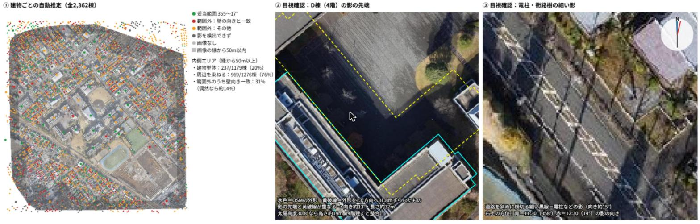

# 航空写真の影から建物の高さを推定する
### 撮影時刻の分からない航空写真で、PLATEAUの基準建物を手がかりにClaudeはどこまで高さを推定できるか ― 青山学院大学相模原キャンパス周辺を対象として ―（仮題）

**青山学院大学 地球社会共生学部 古橋研究室／2026年度ゼミ論**

> **執筆状況（2026年11月9日時点）**：構想段階から中間発表に向けて更新している草稿です。中間発表では、検証の結果ではなく、研究の進め方（手法、評価の方法、公開するもの）を説明します。研究室のドローン画像での試行と、より広い範囲を写すBing航空写真での本調査は、中間発表の後に行います（Bingの利用条件は先生に確認中）。試行で得た結果と、これから行う計画を区別して書いています（【試行済】【計画】【要確認】）。Claudeによる建物の高さの推定結果は、まだ載せていません。

- **中間発表資料**
  - [スライド（Googleスライド）](https://docs.google.com/presentation/d/1CAlxhTW7yFkt06DSbfrGHwO-LAsVXU72HHgXqXcQikQ/edit?usp=sharing)・[PDF](docs/midterm/midterm_slides.pdf)
  - [Medium記事](https://medium.com/furuhashilab/%E6%92%AE%E5%BD%B1%E6%99%82%E5%88%BB%E3%81%AE%E5%88%86%E3%81%8B%E3%82%89%E3%81%AA%E3%81%84%E8%88%AA%E7%A9%BA%E5%86%99%E7%9C%9F%E3%81%A7-ai%E3%81%AF%E5%BD%B1%E3%81%8B%E3%82%89%E5%BB%BA%E7%89%A9%E3%81%AE%E9%AB%98%E3%81%95%E3%82%92%E8%AA%AD%E3%82%81%E3%82%8B%E3%81%8B-1d8f15852d91)・[原稿（Markdown）](docs/midterm/medium_article.md)
  - [グラレコ](docs/midterm/graphic_recording.png)
  - 質疑応答Issue（後で追記）
- [先行研究のまとめ](docs/prior-research.md)
- [影の向きの予備試行](docs/shadow-direction-validation.md)
- [試行に使ったスクリプト](src/shadow_direction_browser.js)
- [構想発表時点のREADME（FIT認定太陽光発電設備と災害区域の重複分析）](https://github.com/furuhashilab/2026gsc_Yuto-Watanabe/blob/825f846c6a21b58ae996fc20755b88ba9bdbfccb/README.md)
- [見直し案のREADME（淵野辺駅周辺200棟の判別と現地調査）](https://github.com/furuhashilab/2026gsc_Yuto-Watanabe/blob/688dfcb56c5263869c6c94cf33f9d37526453457/README.md)



## Abstract（概要・暫定）

建物の高さは、延焼のシミュレーションや3D都市モデルの基礎になる情報である。しかし、建物の高さを整備したPLATEAUがある都市は全国で306にとどまり、それ以外の地域で頼れるOpenStreetMap（OSM）の建物には、高さや階数が入っていないものが多い。航空写真に写る影から高さを求めるには太陽の高さが必要だが、Bing航空写真のように多くの写真をつないだ画像では、区画ごとの撮影時刻が分からない。本研究では、同じ写真に写る高さの分かった建物（基準建物）との影の長さの比から高さを求める比率法を使い、区画ごとの撮影時刻が分からない航空写真で、汎用の画像対応AI（Claude）が建物の高さをどこまで推定できるかを、PLATEAUの計測高さを正解として検証する。同じ写真がもとになっている範囲は、影の向きの違いから見つけて区画とする。中間発表では、研究の進め方を示す。中間発表の後、研究室のドローン画像で手法を試し、より広い範囲を写すBing航空写真で本調査を行う予定である。手法をBingにそのまま使えるよう、ドローン画像でも撮影時刻の情報は使わない。方針を決める前の予備試行で、影の向きを建物1棟ずつ画像だけから自動推定したところ、ありえる範囲に入ったのは20%にとどまった。一方、電柱の影などの確かな目印からは、影の向きを読み取れた。この結果から、影の向きは目印で確かめ、建物ごとには影の長さだけを測る方針とした。Claudeが作った解析の手順は、再現できるツールとして公開する。

**キーワード：** 建物高さ推定、影、航空写真、比率法、PLATEAU、OpenStreetMap、汎用AI（Claude）

---

## 構想発表からの変更点

| 時期 | テーマ | 内容 |
| --- | --- | --- |
| 構想発表 | FIT認定太陽光発電設備と洪水・土砂災害区域の重複分析 | 相模原市の設備と災害区域をGISで重ね、件数と発電出力を集計する |
| 見直し案（2026年11月初め） | 淵野辺駅周辺の建物200棟のAI判別と現地調査 | Claudeが航空写真から用途・階数・屋根の形を判別し、公道からの現地調査と照合する |
| 現在（2026年11月の面談後） | 撮影時刻の分からない航空写真での建物の高さ推定 | 現地調査の代わりに、PLATEAUの計測高さを正解に使う。中間発表では研究の進め方を説明する。その後、研究室のドローン画像で試行し、本調査はBing航空写真で行う予定 |

「航空写真をAIがどこまで読めるか」という関心は見直し案から引き継いでいる。現在の案では、AIに影という幾何学的な手がかりと基準の高さを与え、数値（m）で評価できる形にした。

---

## I. Introduction（研究背景・目的）

### 1.1 背景

建物の高さは、延焼や浸水のシミュレーション、日照の検討、3D都市モデルの基礎になる。相模原市は延焼シミュレーションに、PLATEAUから取得した階数を使っている（[PLATEAU活用事例資料](https://www.mlit.go.jp/plateau/file/events/doc/2025_2-3_sagamihara.pdf)）。

相模原市では、淵野辺駅やキャンパス周辺を含む相模原都市計画区域（104.3km²）の建物に、PLATEAUで高さが整備されている。しかし、PLATEAUがある都市は全国で306（2026年3月末時点、[PLATEAUオープンデータ](https://www.mlit.go.jp/plateau/open-data)）で、市区町村の2割に満たない。それ以外の地域ではOSMの建物に頼ることになるが、高さの情報は少ない。研究室のドローン画像の範囲にある2,362棟のうち、OSMに階数（`building:levels`）が入っているのは361棟（15%）だった【試行済】。

航空写真の影から高さを求めるには、撮影したときの太陽の高さが必要になる。しかし、Bing航空写真は多くの写真をつないだ画像で、撮影日は日付の幅でしか分からず、時刻は公開されていない（[OpenStreetMap Wiki: Bing Maps](https://wiki.openstreetmap.org/wiki/Bing_Maps)）。区画ごとに撮影時刻が違えば、影の長さと向きも区画ごとに変わる。影の向きから同じ写真がもとになっている範囲を見つけ、その範囲にある高さの分かった建物の影との比で高さを求めれば、撮影時刻が分からなくても推定できる可能性がある。

### 1.2 先行研究

2024年以降の研究から、本研究に近いものを選んだ（詳細は[先行研究のまとめ](docs/prior-research.md)）。

| 研究 | 何をしたか | 本研究との共通点 | 本研究との違い・注意 |
| --- | --- | --- | --- |
| GlobalBuildingAtlas（Zhu et al., 2025） | 約3mの衛星画像から、高さ推定専用に訓練した深層学習モデルで、世界中の建物の高さを推定。RMSEは世界平均5.5m、アジア5.9m | 建物1棟ごとに高さを付ける。建物の外形にOSMを使う。同じ場所を複数回推定して、ばらつきを不確かさとする | 影は使っていない。モデルによる推定値で、日本での精度は示されておらず、正確な高さとしての確証はない |
| Xie et al.（2026） | 0.45mの衛星画像（WorldView-3）1枚で、影の長さから高さを計算。建物の並び方で地区に分け、地区ごとに補正。中国13都市・11,168棟で平均誤差2.07m | 1枚の画像の影から高さを出す。地区に分けて扱う。密集地で影が隣の建物にさえぎられることを課題としている | 太陽と衛星の角度を画像の付属情報から得ている。影は手作業で描き、はっきりした影の建物だけを使った。正解は地図サービスの階数×3mで、実測の高さではない |
| Chaudhry et al.（2024） | Google Earthの画像で建物と影を検出し、影の長さから高さを計算。RMSE 3.84m | 撮影時刻の分からない画像の影から高さを出す | 撮影時刻を正解から逆算している。計算がうまくいった建物だけで評価している |
| Ma et al.（2025） | PLATEAUの計測高さを正解に、建物の形・用途地域・屋根の種類・道路から機械学習で高さを推定。仙台・前橋・大牟田・茅野・徳島の15,036棟で平均誤差3.50m | PLATEAUの計測高さを正解にした日本の研究。PLATEAUのない地域に高さを付けることを目的とし、道具も公開している | 影も画像からの高さの読み取りも使わない（画像は屋根の種類の判定だけ）。2.4〜40mの建物に絞っている |
| ShadowBench（Morita et al., 2026） | 汎用AIが写真の影の向きを読めるかを評価。5方向から選ぶ問題で、Gemini-3.1-proは74.8%、GPT-5は52.2%、人は84.7%。30°刻みでは最も良いモデルでも正解31% | 汎用AIが影の向きを読み取れるかという、方式Aと区画分けの前提を扱う | 地上で撮った写真で、航空写真ではない。Claudeは評価されていない。影から高さは出していない |
| GeoHeight-Bench（Hu et al., 2026）、Geo3DVQA（Tsujimoto et al., 2025） | 汎用AIに航空写真の高さに関する質問をさせる評価。評価されたのはGPT-4o、Gemini-2.5-Flashなど | 汎用AIに航空写真から高さを答えさせる | 建物の高さを答える問題の正答率は、GPT-4oで12.2%、Gemini-2.5-Flashで29.8%（GeoHeight-Bench）。Claudeは評価されておらず、基準の高さも影の手がかりも与えていない |

汎用AIの性能は、モデルの種類と時点によって大きく変わる。ShadowBenchでも、同じ問題でモデルによって正答率が20ポイント以上違った。先行研究の数値は、評価されたモデルでの一例として扱い、本研究の結果と比べるときは、モデルと評価した時期の違いを必ず明記する。

### 1.3 研究目的

区画ごとの撮影時刻が分からない航空写真で、影の向きから同じ写真がもとになっている範囲を見つけ、その範囲の基準建物（PLATEAUの高さ）と影を手がかりに、汎用AI（Claude）が建物の高さをどこまで推定できるかを、PLATEAUの計測高さを正解として明らかにする。

あわせて、Claudeが作った解析の手順（方式B）を、他の人が別の地域でも同じ結果を再現できるツールとして公開する。

### 1.4 リサーチクエスチョン

**主たる問い**：区画ごとの撮影時刻が分からない航空写真で、影と同じ区画にある基準建物の高さを与えたとき、Claudeは建物の高さをどの程度の誤差（m）で推定できるか。

**補助的な問い**

- 影の向きから、同じ写真がもとになっている範囲を区画として見つけられるか（Bing）
- 区画ごとに基準建物を置くと、区画に分けない場合より誤差は小さくなるか（Bing）
- 基準建物は何棟あればよいか（1棟・3棟・5棟で比べる）
- 影が測れない建物はどれだけあり、どのような建物か
- Claudeが画像を見て判断する方法（方式A）と、Claudeが影を測るプログラムを作る方法（方式B）で、精度はどう違うか

---

## II. Methods（研究方法）

### 2.1 研究の進め方と対象範囲

| 段階 | 画像 | 範囲 | ねらい |
| --- | --- | --- | --- |
| 試行（中間発表の後） | 研究室のドローン画像 | ドローン画像の範囲（約1km四方） | 手法を確かめる。撮影が1時間に収まっているため区画には分けず、画像全体で同じ基準建物を使う。Bingにそのまま使えるよう、撮影時刻の情報は使わない |
| 本調査（中間発表の後）【要確認】 | Bing航空写真 | キャンパス周辺のより広い範囲（相模原都市計画区域の中で決める） | 影の向きから同じ写真がもとになっている範囲を見つけて区画に分け、区画ごとに基準建物を置いて比率法の精度を確かめる |

Bing航空写真は、利用してよいか先生に確認してから使う。使えない場合は、地理院の航空写真に差し替える。

### 2.2 使用データ

| データ | 内容 | 用途 | 利用条件 | 状況 |
| --- | --- | --- | --- | --- |
| 研究室のドローン画像 | 2021年12月15日 11:30〜12:30撮影、約2.7cm | 影の測定（試行） | OpenAerialMap、CC BY 4.0 | 【試行済】 |
| Bing航空写真（OSMの背景画像） | 多くの写真をつないだ画像。撮影日は日付の幅のみ、時刻は不明 | 影の測定（本調査） | OSM Wikiでは、OSMの作図以外の利用は許されないとされている | 【要確認】先生に確認するまで使わない |
| 地理院タイルの航空写真 | 約0.5m | Bingが使えない場合の代わり | 出典の記載で利用可 | 【計画】 |
| PLATEAU 相模原市（2023年度） | 計測高さ（`bldg:measuredHeight`、単位m） | 正解・基準建物 | Project PLATEAUサイトポリシー | 【確認済】ドローン画像の範囲の2,895棟のうち、2,864棟（99%）に入っている |
| OpenStreetMapの建物 | 建物の外形 | 対象建物の一覧と形 | ODbL | 【試行済】 |
| ドローン画像のDSM | 同じ飛行から作られた地表の高さ | 高さの確認（候補） | OpenAerialMap、CC BY 4.0 | 【要確認】 |

PLATEAUの計測高さを正解に使うのは、古橋先生から信頼できるデータであると助言を受けたためである。計測高さは、地面から建物の一番高い点までの高さである。正解も基準建物の高さも計測高さ（m）に統一し、地上階数は使わない。

### 2.3 高さの推定方法【計画】

基準建物の高さ h₀ と影の長さ L₀、推定したい建物の影の長さ L から、比率法で高さ h を求める。

```text
h = h₀ × L ÷ L₀
```

- **撮影時刻**：使わない。Bingでは分からないため、ドローン画像でも同じ条件で行う。
- **影の向き**：建物1棟ずつの自動推定は当てにならなかった（3.2）。そのため、電柱の影や大きな建物の影の先端などの目印で確かめる。ドローン画像では画像全体で1つの向き、Bingでは区画ごとの向きとする。
- **影の長さ**：その向きに沿って、建物の外形から影の先端までを測る。影が他の建物や樹木にかかる建物は「測れない」として数を記録する。先端が見えない影を無理に測ると、大きく外れるためである。
- **基準建物**：PLATEAUの計測高さを使う。ドローン画像では画像全体で、Bingでは区画ごとに選ぶ。基準以外の建物の正解は推定に使わない。評価に使う正解を推定に使うと、精度が実際よりよく見えてしまうためである。
- 各建物について3回推定し、ばらつきを不確かさとして記録する（GBAの考え方を取り入れる）。

**方式A：Claudeが画像を見て答える**

対象建物と基準建物が写った画像、基準建物の計測高さ、縮尺（1画素＝何m）、方位をClaudeに渡す。高さ（m）、読み取った影の長さ、測れない場合はその理由を、決まった形で答えさせる。

**方式B：Claudeが作ったプログラムで測る**

Claudeに次の処理を行うプログラムを作らせ、そのプログラムで全建物を推定する。

1. 航空写真とOSMの建物外形を読み込み、位置を合わせる
2. 明るさから、影になっている部分を見分ける
3. 基準建物の影の先端から、影の向きと基準の影の長さ L₀ を求める（Bingでは区画ごと）
4. 対象建物ごとに、その向きに沿って外形から影の先端までの長さ L を測る。影が他の建物などにかかる場合は「測れない」とする
5. 比率法で高さを計算する
6. 結果を、建物ごとの表（CSV・GeoJSON）と誤差マップ（2.4）として出力する

このプログラムは、他の地域でも同じ手順で再現できるツールとして公開する（2.7）。

**方式Aと方式Bの違い**

どちらも作業の自動化にはプログラムを使うが、建物1棟ずつの判断をする主体が違う。方式Aでは、プログラムは画像をClaudeに渡して答えを記録するだけで、影の長さの読み取りと高さの判断は毎回Claudeが行う。方式Bでは、推定のあいだClaudeは呼ばれず、Claudeが事前に作ったプログラムが影を見分け、長さを測り、高さを計算する。

| | 方式A（Claudeが見て答える） | 方式B（Claudeが作ったプログラムが測る） |
| --- | --- | --- |
| Claudeが判断する回数 | 建物の数×3回 | プログラムを作るときだけ |
| 試すAIの力 | 写真の影を読む力 | 測り方を考えてプログラムに組み立てる力 |
| 得意そうなこと | 状況の理解（木の影や、隣の建物にかかった影の見分け） | 細かい長さの正確な測定 |
| 苦手そうなこと | 細かい長さの読み取り。汎用AIは影の向きの細かい判定も苦手という報告がある（ShadowBench。評価されたのはGPT-5・Gemini-3.1-proなどで、Claudeは含まれない） | 状況の理解。予備試行では、建物のすき間の暗い帯を影と取り違えた |
| 予想される間違え方 | 全体に数mずれる、答えが毎回少し揺れる | 影を取り違えた建物で大きく外れる |
| 同じ画像でやり直すと | 答えが少し変わることがある | 必ず同じ結果になる |
| 処理の量 | 建物ごとにAIを使うため、時間と利用量がかかる | 一度作れば数千棟を短時間で処理できる |
| 再現性 | モデルが変わると結果も変わる | プログラムを公開すれば、誰でも同じ結果を再現できる |

**方式Aと方式Bを両方行う理由**

- 得意なことと苦手なことが逆で、間違え方も違うと考えられる。同じ建物・同じ正解で比べると、「AIに直接答えさせる」のと「AIに道具を作らせる」のとで、どちらが建物の高さ推定に向くか、それぞれどこで失敗するかが分かる。これは、地理空間の分析にAIをどう使えばよいかの指針になる。
- 誤差の原因を切り分けられる。同じ建物で両方が外れれば、画像や正解の側（影がさえぎられている、など）に原因がある。片方だけが外れれば、その方式の弱点と分かる。
- 本研究の2つの目的に対応する。「Claudeが影からどこまで高さを推定できるか」は方式Aが中心で、「再現できるツールの公開」は方式Bが中心になる。

**使うAIモデル**

- 方式Aで答えるモデルと、方式Bでプログラムを作るモデルは、同じ1つのモデルにそろえる。
- 使うモデルは試行の前に決め、正確なモデル名（ID）、使った日付、指示文の全文、Claudeの回答を記録する。
- 研究の途中でモデルが更新されても、最初に決めたモデルを使い続ける。使えなくなった場合は、その経緯と代わりのモデルを記録する。
- Claudeの使い方（研究室のプランでClaude Codeを使うか、APIを使うか）は、研究室の契約内容を確認して決める【要確認】。

**区画分け（Bingのみ）**

- 影の向きの違いから、太陽の位置がそろっている範囲（同じ写真がもとになっている範囲）を見つけて区画とし、区画ごとに基準建物を置く。こちらで決めた格子や距離では区切らない。
- どれだけ影の向きが違えば別の区画とするかの基準は、推定した高さとPLATEAUの計測高さとの差（m）をもとに、数値で定める【要検討】。基準を決めるのに使った建物は、評価には使わない。
- ドローン画像は区画に分けず、画像全体で同じ基準建物を使う。

Bingでは、区画に分けない場合（画像全体で同じ基準建物）と、区画ごとに基準建物を置く場合を比べる。

### 2.4 評価方法【計画】

- 建物ごとに、推定した高さとPLATEAUの計測高さとの差（推定 − 計測高さ、m）を求める。「合致した」とみなす基準は設けず、差の大きさだけを扱う。全体は、平均絶対誤差（MAE）・RMSE・差の平均（m）でまとめる。
- 影の向きの判定精度は直接は検証せず、その結果として出た高さとPLATEAUの計測高さとの差で評価する。
- Bingでは、区画に分けない場合と区画ごとに基準建物を置く場合の誤差を比べる。
- 低層・中層・高層の区分ごとに誤差を分ける。建物の高さによって影の長さや隣の建物へのかかりやすさが違い、誤差の出方が変わる可能性があるためである。
- 推定できなかった建物（影が測れない、建て替えなど）の数と割合を必ず報告する。
- **誤差マップ**：建物ごとに「推定した高さ − 計測高さ（m）」を色で塗った地図を作る。低く見積もった建物は青、高く見積もった建物は赤、測れなかった建物は灰色にする。あわせて、50m四方などのマスごとに誤差の平均を塗ったヒートマップを作り、どこで精度が落ちるかを示す。地図はGitHub Pagesで公開し、背景にBingの画像は使わない（利用条件を確認中のため）。

### 2.5 Claudeに任せる作業

OSMの建物の取得、画像の読み込み、影の解析、PLATEAUとの照合、集計はClaudeが行う。結果の目視確認と、手法の判断は筆者が行う。

### 2.6 データの利用条件

- Bing航空写真は、利用してよいか先生に確認するまで、取得も解析もしない。
- 画像そのものはリポジトリに置かず、出典を記載する。
- 公開するツールには航空写真を含めない。使う人が、利用条件を満たす画像を自分で用意する。

### 2.7 公開するもの

- 方式Bのツール（プログラムと使い方、MIT License）
- 建物ごとの推定結果（CSV・GeoJSON）
- 誤差マップ（GitHub Pages）
- 方式Aの指示文の全文と、Claudeの回答の記録
- 使ったAIモデルの名前（ID）と使った日付

---

## III. Results（結果：現時点の進捗）

> **注意：** 本節は2026年11月9日時点の進捗であり、建物の高さを推定した結果ではない。

### 3.1 進捗

| 項目 | 状態 | 内容 |
| --- | --- | --- |
| 先行研究の調査 | 完了 | 2024年以降の研究：GBA、影を使った高さ推定、PLATEAUを使った高さ推定、汎用AIの評価研究（[まとめ](docs/prior-research.md)） |
| 研究の進め方 | 決定 | 中間発表では進め方を説明する。ドローン画像での試行と、Bing航空写真での本調査（利用条件の確認後）は中間発表の後に行う |
| Bing航空写真の利用条件 | 確認待ち | OSM Wikiの記述を先生に確認する |
| OSMの建物の取得 | 完了 | ドローン画像の範囲で2,362棟 |
| ドローン画像の読み込み | 完了 | 約0.24m/画素で解析 |
| 影の向きの予備試行 | 試行済 | 方針を決める前の予備的な試行。3.2を参照 |
| PLATEAUの内容確認 | 完了 | ドローン画像の範囲に2,895棟。計測高さ（m）は2,864棟（99%）に入っている |
| 高さの推定（方式A・B） | 中間発表の後 | |

### 3.2 ドローン画像での影の向きの予備試行【試行済】

> 研究の方針を決める前に行った予備的な試行である。この結果から、影の向きは目印で確かめること、ドローン画像は区画に分けないこと、撮影時刻を使わないこと、影の向きの判定精度は直接は検証せず、推定した高さとPLATEAUの計測高さとの差で評価することを決めた。ここでの数値は手法を選ぶための参考であり、研究の評価結果ではない。詳しくは[予備試行のページ](docs/shadow-direction-validation.md)。

**なぜ行ったか**：比率法では、影の長さを影の向きに沿って測るので、まず向きが必要になる。建物1棟ずつ画像だけから向きを読み取れれば、撮影時刻を知らずに長さを測れ、Bingで同じ写真の範囲（区画）を見つける手がかりにもなる。そこで、最も厳しい条件で判別できるかを試した。

**何をしたか**：ドローン画像の範囲にあるOSMの建物2,362棟すべてで、影の向きを自動で推定した。

- 建物1棟ずつ、独立に判別した。見たのは、その建物の外形とまわりの画素だけである。
- 「この辺りの影はだいたいこの向き」といった前提や、隣の建物の結果は一切使っていない。全方位（3°刻み）から、影らしさの点数が最も高い向きを選んだ。
- 撮影時刻は推定に使っていない。使ったのは、あとの答え合わせだけである。
- 見ていたのは撮影した写真1枚1枚ではなく、それらをつなぎ合わせたドローン画像（約0.24m/画素で読み込んだもの）である。

**どう答え合わせしたか**：建物ごとの正解の向きは分からないので、記録上の撮影時間帯（11:30〜12:30）から太陽の位置の式で影の向きを計算した（358°〜14°、北を0°として時計回り）。推定を3°刻みで行った分の余裕を足した355°〜17°を「ありえる範囲」とし、推定した向きがこの範囲に入った割合を数えた。1棟ずつの正答率ではない。

| 区分 | ありえる範囲（355〜17°）に入った建物 |
| --- | --- |
| 画像の縁から50m以上内側：建物1棟ずつの推定 | 237 / 1,179棟（20%） |
| 同じ範囲：周りの建物を束ねた推定（試しの計算。区画分けではない） | 969 / 1,276棟（76%） |
| 画像の縁から50m以内：建物1棟ずつの推定 | 41 / 433棟（9%） |

- 縁から50m以内を分けたのは、縁の近くは写真がつぶれていて、OSMの外形とも合わないためである。
- 1,179棟は、内側の1,278棟から、小さすぎる建物と影を見つけられなかった建物（計99棟）を除いた数である。
- **周りの建物を束ねた推定**：住宅地では1棟の影が隣の家に落ちて読めないことが多い。しかし同じ写真の中なら向きは同じはずなので、周りの多くの建物の傾向を合わせれば向きが出やすくなると考えた。半径約60m以内の建物の点数を、近い建物ほど重く足し合わせて、その場所の向きを決めた。範囲に入った割合は20%から76%に上がった。ただし、束ねても誤る街区があり、この範囲が同じ写真の範囲と一致する保証もないため、研究の手法には使わない。

**分かったこと**：外れた推定の31%は、壁に垂直な向きと一致していた（向きがでたらめなら約14%）。建物のすき間の暗い帯を影と取り違えていたためである。住宅地では、影の大部分が隣の家の屋根に落ちる。一方、目印を使って目で確かめた3か所（大きな建物の影の先端、公園わきの住宅、道路を横切る電柱の影）では、影の向きを約10〜15°と読み取れた。目印があれば向きは読めるので、外れの多くは、建物ごとに自動で判別するという方法の問題だと考えた。

--- | --- |
| 画像の縁から50m以上内側：建物1棟ずつの推定 | 237 / 1,179棟（20%） |
| 同じ範囲：周りの建物を束ねた推定（半径約60m。区画分けではなく試しの計算） | 969 / 1,276棟（76%） |
| 画像の縁から50m以内：建物1棟ずつの推定 | 41 / 433棟（9%） |

外れた推定の31%は壁に垂直な向きと一致しており（偶然なら約14%）、建物のすき間の暗い帯を影と取り違えていた。住宅地では影の大部分が隣の家の屋根に落ちる。一方、目印を使って目で確かめた3か所（D棟の影の先端、公園わきの住宅、道路を横切る電柱の影）では、影の向きを約10〜15°と読み取れた。

---

## IV. Discussion（考察：検証前の論点）

### 4.1 影の向きは目印で確かめる

建物1棟ずつの自動推定は、壁の向きや隣の建物の影に引っぱられ、信頼できなかった。影の向きは、電柱の影や大きな建物の影の先端など、確かな目印で確かめる方が確実である。ドローン画像もBingも多くの写真をつないだ画像で、区画ごとに撮影時刻が違えば、影の向きも長さも変わる。ただしドローン画像は撮影が1時間に収まっており、画像全体で同じ基準建物を使っても問題ないと考える。撮影日や時刻がばらばらな写真をつないだBingでは、影の向きから区画を見つけ、区画ごとに基準建物を置く意味が大きい。

一方で、ShadowBench（Morita et al., 2026）では、汎用AIが写真から読み取れる影の向きは5方向ほどの大まかな区別までだった。区画分けに必要な細かさで向きを読み取れるかは分からないため、方式A（AIが見て判断）と方式B（プログラムで測る）の両方で確かめる。

### 4.2 影が測れない建物

住宅の密集地では、影の多くが隣の建物に落ちる。測れる建物だけで精度を出すと、結果がよく見えすぎる。測れない建物の割合と、その建物の特徴も結果として示す。

### 4.3 新規性（暫定）

| 新規性 | 先行研究との違い |
| --- | --- |
| 撮影時刻も太陽の角度も分からない、写真をつないだ航空写真で、影の向きから同じ写真がもとになっている範囲を見つけて区画とし、区画の中の基準建物との比で高さを出す | Xie et al.（2026）は太陽と衛星の角度を画像の付属情報から得ており、地区分けも建物の並び方で行う。Chaudhry et al.（2024）は撮影時刻を正解から逆算している |
| 汎用AI（Claude）に影と基準建物の高さという「物差し」を与えて高さを推定させる（方式A）。AIが自分で作った道具での推定（方式B）とも比べる | GeoHeight-Bench・Geo3DVQAは物差しを与えておらず、Claudeも評価していない。ShadowBenchは影の向きの読み取りまでで、高さは出していない |
| PLATEAUの計測高さ（実測にもとづく高さ）を正解に、影から出した高さを評価する | Xie et al.（2026）の正解は階数×3m。Ma et al.（2025）はPLATEAUを正解にしているが、影や画像からは高さを出していない |
| 影が測れない建物も含めて、すべての建物で結果を報告する | Xie et al.（2026）ははっきりした影の建物だけを手作業で選び、Chaudhry et al.（2024）は計算がうまくいった建物だけで評価している |
| AIが作った解析の手順を、他の地域でも再現できるツールとして公開する | Ma et al.（2025）も道具を公開しているが、建物の形などから高さを予測するもので、航空写真の影を測るものではない |

### 4.4 限界

- 結果は、使ったClaudeのモデルと時点、対象地域に依存する。他のモデルや今後のモデルに当てはまるとは限らない。
- 本調査は、Bing航空写真の利用が認められることが前提である。認められない場合は、画像を差し替える。
- ドローン画像（2021年）とPLATEAU（2023年度）は時期が異なり、建て替えた建物は除外が必要である。Bingの撮影時期とも照らし合わせる必要がある。

---

## V. 今後の予定

**中間発表まで**

- [ ] Bing航空写真の利用条件を先生に確認する
- [ ] 研究室のClaudeの契約内容を確認し、使うモデルと使い方（Claude Code・API）を決める
- [ ] ドローン画像のDSMが使えるかを確認する
- [ ] 研究の進め方（方式A・方式Bの手順、評価の方法、公開するもの）を図にまとめる
- [ ] 中間発表の資料を作る

**中間発表の後**

- [ ] 試行：ドローン画像で、画像全体で同じ基準建物を使い、方式Aと方式Bで高さを推定する
- [ ] 試行の結果を誤差マップ・ヒートマップにする
- [ ] 本調査の範囲を決める
- [ ] 別の区画とする基準（影の向きが何度以上違えば分けるか）を、推定した高さと計測高さとの差をもとに数値で定める
- [ ] 方式Bのツールを作り、使い方と合わせて公開する
- [ ] Bing航空写真（使えない場合は代わりの写真）で本調査を行う

---

## 参考文献（暫定）

- Zhu, X. X., Chen, S., Zhang, F., Shi, Y., & Wang, Y. (2025). [GlobalBuildingAtlas: an open global and complete dataset of building polygons, heights and LoD1 3D models](https://essd.copernicus.org/articles/17/6647/2025/). *Earth System Science Data*, 17, 6647–6668.（コード：[zhu-xlab/GlobalBuildingAtlas](https://github.com/zhu-xlab/GlobalBuildingAtlas)）
- Chaudhry, S., Qureshi, M., Jabbar, S., & Taj, M. (2024). [Building Height Estimation Using Shadow Length in Satellite Imagery](https://arxiv.org/abs/2411.09411). arXiv:2411.09411.
- Xie, Y., Tu, J., Zhao, Y., Xia, R., Song, W., Feng, D., & Hu, Y. (2026). [Single-Image Building Height Estimation Using Spatial Distribution-Aware Optimization in Complex Urban Areas](https://www.mdpi.com/2072-4292/18/5/801). *Remote Sensing*, 18(5), 801.
- Ma, J., Zhao, C., Ogawa, Y., & Sekimoto, Y. (2025). [Predicting Building Height from Footprint and Urban Planning Information for Digital Twin Generation](https://isprs-archives.copernicus.org/articles/XLVIII-4-W15-2025/107/2025/isprs-archives-XLVIII-4-W15-2025-107-2025.pdf). *ISPRS Archives*, XLVIII-4/W15-2025, 107.
- Morita, R., Kitada, S., Frolov, S., Moser, B. B., Watanabe, K., Takahashi, R., Zhou, J., & Dengel, A. (2026). [Where Did the Light Come From? Diagnosing Cast-Shadow Reasoning in VLMs and Borrowing the Missing Shadow Prior from Image Generation Models](https://arxiv.org/abs/2610.30740). arXiv:2610.30740（WACV 2027採択）.
- Hu, X., Xiong, Z., Hong, Z., Ban, Y., Zhu, X., & Zhao, W. (2026). [GeoHeight-Bench: Towards Height-Aware Multimodal Reasoning in Remote Sensing](https://arxiv.org/abs/2603.25565). arXiv:2603.25565.
- Tsujimoto, M., Wang, J., Xuan, W., & Yokoya, N. (2025). [Geo3DVQA: Evaluating Vision-Language Models for 3D Geospatial Reasoning from Aerial Imagery](https://arxiv.org/html/2512.07276v2). arXiv:2512.07276.

**データ・資料**

- [PLATEAUオープンデータ（国土交通省）](https://www.mlit.go.jp/plateau/open-data)
- [G空間情報センター：3D都市モデル（Project PLATEAU）相模原市（2023年度）](https://www.geospatial.jp/ckan/dataset/plateau-14150-sagamihara-shi-2023)
- [PLATEAU標準仕様：計測高さ（bldg:measuredHeight）](https://www.mlit.go.jp/plateaudocument02/tocC/tocC_03/tocC_03_02/tocC_03_02_03)
- [PLATEAU活用事例資料（相模原市）](https://www.mlit.go.jp/plateau/file/events/doc/2025_2-3_sagamihara.pdf)
- [OpenStreetMap Wiki: Bing Maps](https://wiki.openstreetmap.org/wiki/Bing_Maps)
- [OpenAerialMap](https://map.openaerialmap.org/)：sagamihara20211215aoyamauniv1155mapconcierge00arw01（CrisisMappersJapan/DRONEBIRD/FuruhashiLab/YouthMappersAGU、CC BY 4.0）
- [国土地理院：地理院地図の地上画素寸法](https://www.gsi.go.jp/gazochosa/gazochosa41015.html)
- [古橋研究室 卒論・ゼミ論ルール](https://github.com/furuhashilab/README/issues/5)

---

## ライセンス

本リポジトリに掲載する研究文章及び著者が作成した図表は、
Creative Commons Attribution 4.0 International（CC BY 4.0）
の下で提供します。

本リポジトリに掲載する自作プログラムは、
MIT Licenseの下で提供します。

ただし、国土交通省（PLATEAU）、国土地理院、OpenStreetMap、OpenAerialMap等から取得した
第三者データには、それぞれの提供元が定める利用規約が適用されます。
第三者データの権利を本ライセンスによって許諾するものではありません。

図（docs/images）には、OpenAerialMapのドローン画像（CrisisMappersJapan/DRONEBIRD/FuruhashiLab/YouthMappersAGU、CC BY 4.0）と、OpenStreetMapの建物（© OpenStreetMap contributors、ODbL）を使用しています。
