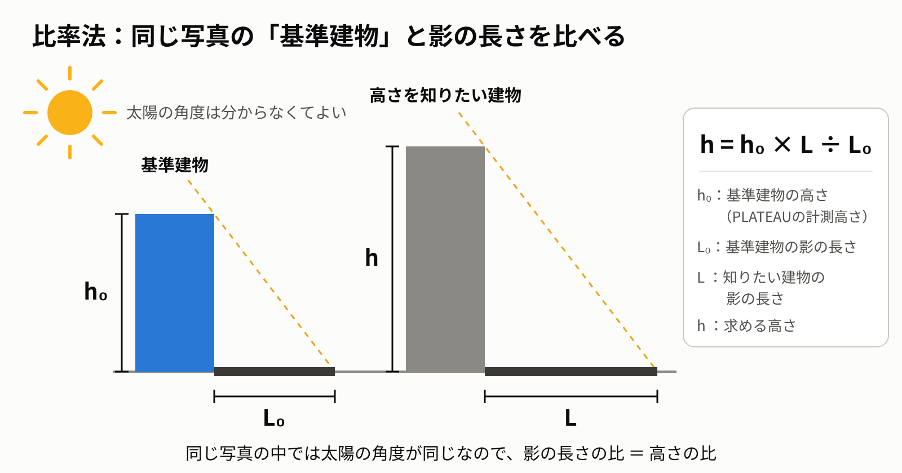
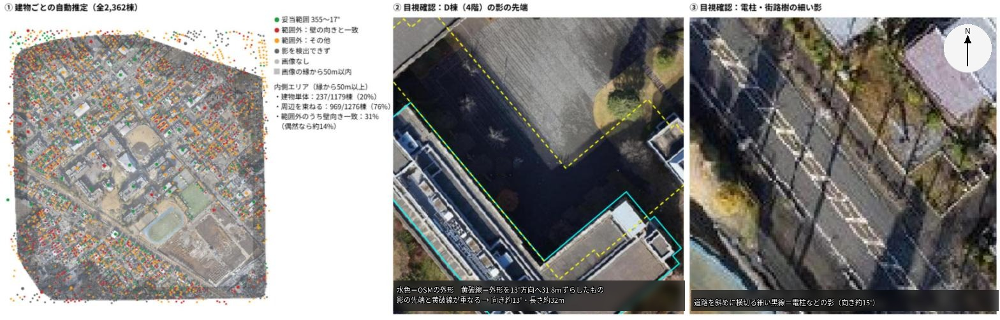
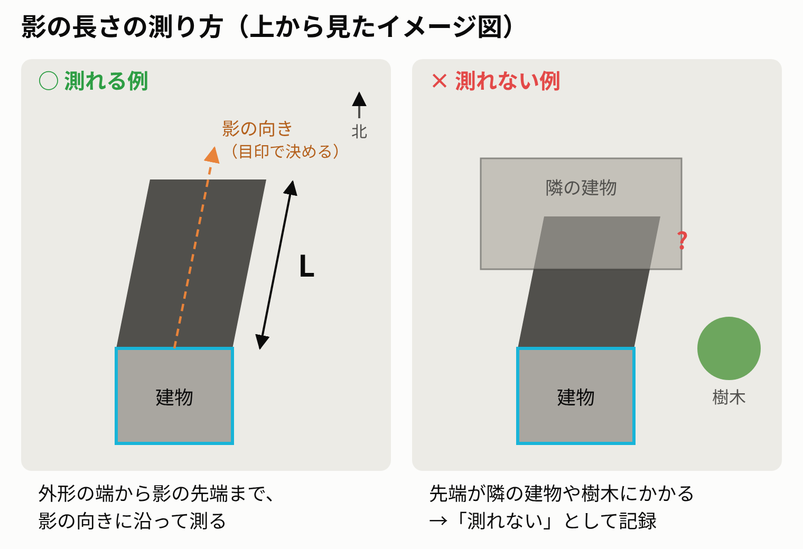
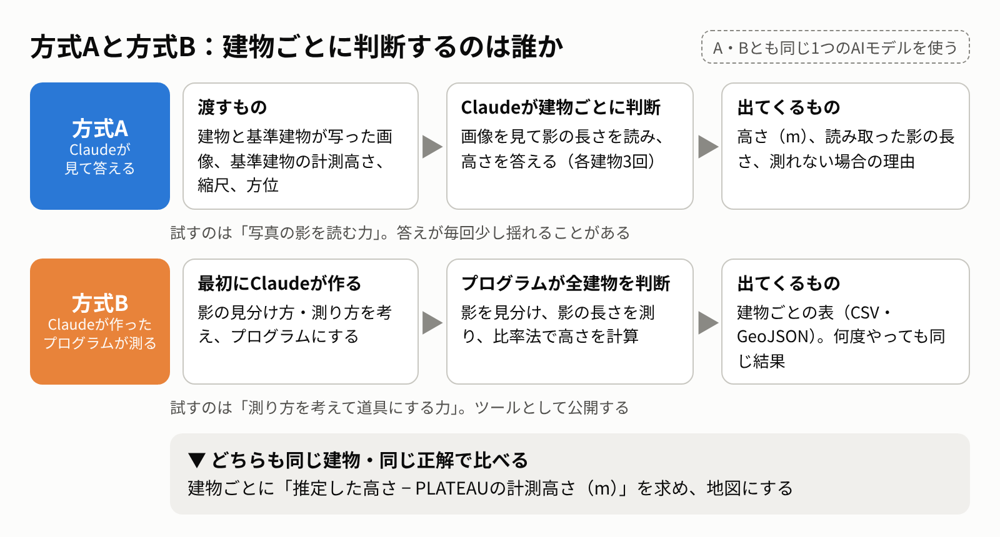
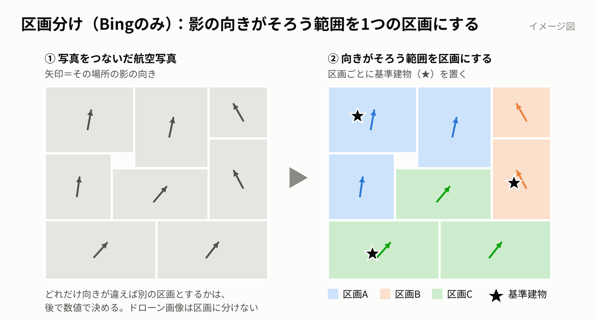
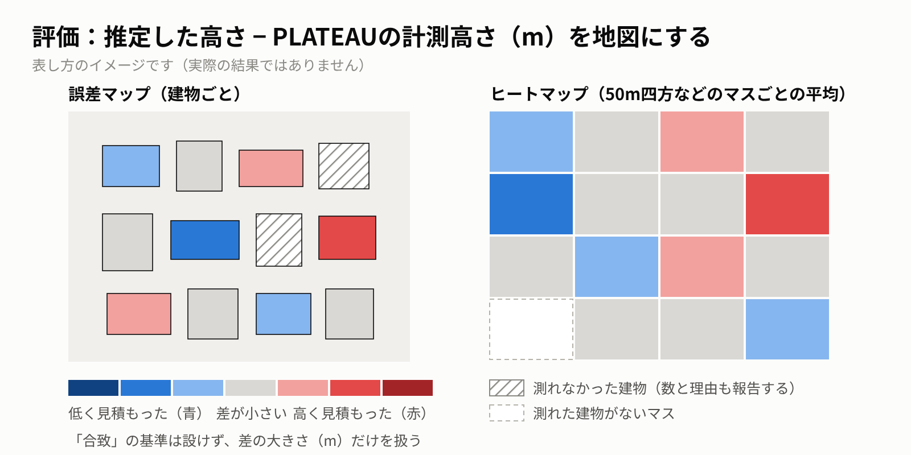
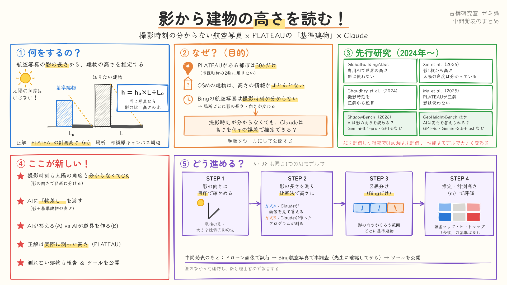

# 撮影時刻の分からない航空写真で、AIは影から建物の高さを読めるか

> この記事は、中間発表に合わせて[Medium](https://medium.com/furuhashilab/%E6%92%AE%E5%BD%B1%E6%99%82%E5%88%BB%E3%81%AE%E5%88%86%E3%81%8B%E3%82%89%E3%81%AA%E3%81%84%E8%88%AA%E7%A9%BA%E5%86%99%E7%9C%9F%E3%81%A7-ai%E3%81%AF%E5%BD%B1%E3%81%8B%E3%82%89%E5%BB%BA%E7%89%A9%E3%81%AE%E9%AB%98%E3%81%95%E3%82%92%E8%AA%AD%E3%82%81%E3%82%8B%E3%81%8B-1d8f15852d91)に投稿した記事の原稿です。[README に戻る](../../README.md)

## PLATEAUの「基準建物」を物差しに、Claudeで影から高さを推定する研究の進め方（ゼミ論 中間発表）

青山学院大学 地球社会共生学部の古橋研究室で、ゼミ論に取り組んでいます。この記事では、中間発表に合わせて、研究で何をするのか、なぜするのか、どう進めるのかをまとめます。推定の結果は、研究を進めたあとに紹介します。

---

## 1. 何をするのか

航空写真に写る建物の「影」から、建物の高さを推定します。推定には、画像を読み取れる汎用のAI（Claude）を使います。

建物が高いほど、影は長くなります。ただし、影の長さを高さに直すには、撮影したときの太陽の高さ（角度）が必要です。この研究では太陽の角度を使わず、同じ写真に写っている「高さの分かった建物（基準建物）」の影と比べて高さを出します。この方法を比率法と呼びます。

> **h ＝ h₀ × L ÷ L₀**
>
> h₀：基準建物の高さ　L₀：基準建物の影の長さ　L：高さを知りたい建物の影の長さ

同じ写真の中なら、太陽の角度はどの建物でも同じです。そのため、影の長さの比がそのまま高さの比になります。撮影時刻も太陽の角度も使わないので、撮影時刻の分からないBing航空写真にも同じ手順で使えます。

*比率法の考え方。同じ写真の中では太陽の角度がどの建物でも同じなので、影の長さの比がそのまま高さの比になる。*

対象は、青山学院大学 相模原キャンパスの周辺です。推定した高さは、国土交通省の3D都市モデル「PLATEAU」の計測高さ（地面から建物の一番高い点までの高さ、単位m）を正解として、何mずれたかを調べます。基準建物の高さにも、同じ計測高さを使います。PLATEAUを正解にするのは、古橋先生から信頼できるデータだと助言を受けたからです。

---

## 2. 目的

### 建物の高さが分からない地域が多い

建物の高さは、火事の燃え広がり（延焼）や浸水のシミュレーション、日当たりの検討、3D都市モデルの土台になる情報です。しかし、PLATEAUのデータがある都市は全国で306（2026年3月末時点）で、市区町村の2割に足りません。

それ以外の地域では、誰でも編集できる地図「OpenStreetMap（OSM）」の建物データに頼ることになります。ところが、OSMの建物には高さの情報がほとんど入っていません。研究室のドローン画像の範囲にあるOSMの建物2,362棟のうち、何階建てかの情報が入っていたのは361棟（15%）でした。

### 航空写真は、場所ごとに撮影時刻が分からない

OSMの作図によく使われるBing航空写真は、広い範囲を写していますが、たくさんの写真をつなぎ合わせた画像です。撮影日は日付の幅でしか分からず、時刻は公開されていません。撮影時刻が違えば太陽の角度も違うので、場所ごとに影の長さや向きが変わってしまいます。

### この研究で明らかにしたいこと

1. 区画ごとの撮影時刻が分からない航空写真で、影の向きから「同じ写真がもとになっている範囲」を見つけます。その範囲の基準建物と影を手がかりに、Claudeが建物の高さをどこまで推定できるかを、PLATEAUの計測高さを正解として確かめます。
2. Claudeが作った解析の手順を、他の人が別の地域でも同じ結果を出せるツールとして公開します。

中心となる問いは「撮影時刻が分からない航空写真で、影と、同じ区画にある基準建物の高さを与えたとき、Claudeは建物の高さを何mくらいの誤差で推定できるか」です。

---

## 3. 先行研究

2024年以降の研究から、この研究に特に近い3つを、高さの求め方に注目して紹介します。AIの性能はモデルと時期で大きく変わるため、AIを評価した研究では、評価されたモデルの名前も書きます。

### Xie et al.（2026）：影の長さに、角度から計算した係数を掛ける

- **データ**：中国13都市の衛星画像（0.45m）、11,168棟
- **高さの求め方**：建物の影を手で描いて長さを測り、太陽と衛星の角度から計算した係数を掛けて高さにする
- **前提**：太陽と衛星の角度は、画像の付属情報から得る。影は、はっきりした建物だけを手作業で選んでいる
- **結果**：平均誤差2.07m。ただし正解は地図サービスの「階数×3m」で、実際に測った高さではない

### GlobalBuildingAtlas（Zhu et al., 2025）：高さ専用に訓練したAIで予測する

- **データ**：世界中の衛星画像（約3m）
- **高さの求め方**：高さ推定専用に訓練したAIで、画素ごとに高さを予測し、建物の中の最大値をその建物の高さにする
- **前提**：影は使わない。学習の見本には、飛行機からレーザを当てて測った168都市の建物の高さを使っている（アジアは2都市）
- **結果**：誤差の目安は世界平均で約5.5m（大きく外れた建物を重く数えた値）。日本での精度は示されていない

### GeoHeight-Bench（Hu et al., 2026）：汎用AIに写真だけで高さを答えさせる

- **データ**：アメリカ・ドイツ・フランスの航空写真
- **高さの求め方**：汎用AIに写真だけを見せ、建物の高さを直接答えさせる
- **前提**：影や基準の高さといった手がかりは渡さない。評価されたのはGPT-4o、Gemini-2.5-Flashなどで、Claudeは評価されていない
- **結果**：正答率はGPT-4oで12.2%、Gemini-2.5-Flashで29.8%

まとめると、影から高さを出すには太陽の角度の情報が必要で、角度を使わない方法は大量のデータで専用に学習させたAIに頼っています。一方、汎用AIに写真だけを見せても、高さはほとんど当たりません。この研究は、角度も専用の学習も使わず、同じ写真の基準建物と影を比べる方法を、汎用AI（Claude）で試します。

### そのほかの関連研究

- **Chaudhry et al.（2024）**：撮影時刻の分からないGoogle Earthの画像で、AIが影を見つけて長さを予測し、高さを計算しました。ただし、計算に必要な撮影時刻を、評価に使う正解の高さに最も合うように選んでいます。評価も計算がうまくいった建物に絞っています（誤差の目安3.84m）。査読前の原稿（arXiv）です。
- **Ma et al.（2025）**：PLATEAUの計測高さを正解に、建物の形や用途地域などから機械学習で高さを予測しました（5都市の15,036棟、平均誤差3.50m）。影や画像から高さは読み取っていません。
- **ShadowBench（Morita et al., 2026）**：汎用AIが写真の影の向きを読めるかを調べました。5方向から選ぶ問題で、正答率はGemini-3.1-proが74.8%、GPT-5が52.2%、人が84.7%でした。同じ問題でもモデルによって20ポイント以上違い、Claudeは評価されていません。

先行研究の数値は「評価されたモデルでの一例」として扱い、この研究の結果と比べるときは、モデルと時期の違いを必ず書きます。

---

## 4. この研究の新規性

1. **撮影時刻も太陽の角度も分からない航空写真で高さを出す。** 影の向きから同じ写真がもとになっている範囲（区画）を見つけ、区画の中の基準建物との比で高さを出します。Xie et al.は角度を画像の付属情報から得ており、Chaudhry et al.は撮影時刻を正解に合わせて決めています。
2. **汎用AIに「物差し」を渡して高さを推定させる。** 専用の学習はせず、Claudeに影と基準建物の高さという手がかりを渡します（方式A）。さらに、AIが自分で作った道具での推定（方式B）とも比べます。AIを評価した先行研究は手がかりを与えておらず、Claudeも評価していません。
3. **実際に測った高さを正解にする。** PLATEAUの計測高さで、影から出した高さを評価します。Xie et al.の正解は「階数×3m」です。Ma et al.はPLATEAUを正解にしていますが、影や画像からは高さを出していません。
4. **測れない建物も含めて報告する。** Xie et al.は影がはっきりした建物だけを手作業で選び、Chaudhry et al.は計算がうまくいった建物だけで評価しています。
5. **AIが作った解析の手順を、ツールとして公開する。** 他の地域でも同じ手順で再現できるようにします。

---

## 5. 具体的な進め方

### 使うデータ

- **研究室のドローン画像**（2021年12月撮影、約2.7cm、OpenAerialMap、CC BY 4.0）：手法を試す（試行）。研究室で撮影した画像で、利用条件がはっきりしているため
- **Bing航空写真**：本調査（広い範囲）に使う予定。写真をつないだ画像で、撮影時刻は分かりません。利用してよいかを先生に確認中で、確認できるまでは使いません。使えない場合は国土地理院の航空写真に替えます
- **PLATEAU 相模原市（2023年度）の計測高さ**：正解と基準建物の高さ。ドローン画像の範囲にある2,895棟のうち、2,864棟（99%）に計測高さが入っていることを確認しました
- **OSMの建物**：建物の外形（位置と形）。ドローン画像の範囲で2,362棟

### 手法の全体像：5つのステップ

1. **影の向きを決める**：電柱の影や大きな建物の影の先端（目印）から、写真ごとに1つの向きを決める
2. **基準建物を選ぶ**：影が開けた地面に落ちる建物を選び、PLATEAUの計測高さ h₀ と影の長さ L₀ を使う
3. **影の長さを測る**：決めた向きに沿って、建物の外形から影の先端までの長さ L を測る（方式A・Bの2通り）
4. **高さを計算する**：h ＝ h₀ × L ÷ L₀（撮影時刻も太陽の角度も使わない）
5. **正解と比べる**：推定した高さ − PLATEAUの計測高さ（m）を建物ごとに求め、地図にする

Bing航空写真では、影の向きがそろう範囲（区画）ごとに、STEP1〜4を行います。以下、ステップごとに説明します。

### STEP1：影の向きは目印で確かめる

比率法では、影の長さを「影が伸びる向き」に沿って測ります。そのため、まず向きが必要です。同じ写真の中なら太陽は1つなので、どの建物の影も同じ向きに伸びます。ただ、写真をつないだ画像では、写真ごとに向きが変わります。

もし建物1棟ずつ、画像だけから向きを読み取れれば、撮影時刻が分からなくても長さを測れます。向きの違いから、同じ写真の範囲（区画）も見つけられます。そこで方針を決める前に、ドローン画像の2,362棟で予備試行をしました。

- 建物1棟ずつ、まわりの画素だけを見て、全方位から影らしい向きを自動で選びました。「この辺りの影はだいたいこの向き」といった前提や、隣の建物の結果は使っていません。
- 答え合わせには、記録上の撮影時間帯（11:30〜12:30）から計算した影の向きの「ありえる範囲」を使いました。撮影時刻を使ったのは、この答え合わせだけです。

範囲に入ったのは、画像の内側で20%だけでした。建物のすき間の暗い帯を影と取り違えたり、影が隣の家の屋根に落ちていたりしたためです。同じ写真なら向きは同じはずなので、周りの建物の結果を束ねてみると76%に上がりましたが、それでも誤る街区が残りました。一方、電柱の影や大きな建物の影の先端といった目印では、向きを読み取れました。

そこで、影の向きは少数の目印で確かめ、建物ごとには、その向きに沿った影の長さだけを測ることにしました。

*影の向きの予備試行。①建物1棟ずつの自動推定（緑＝ありえる範囲に入った）、②大きな建物の影の先端、③道路を斜めに横切る電柱などの細い影。この試行に限り、自動推定の答え合わせに記録上の撮影時間帯を使った。研究の手法では撮影時刻は使わない。画像：OpenAerialMap（提供 CrisisMappersJapan/DRONEBIRD/FuruhashiLab/YouthMappersAGU、CC BY 4.0）、建物：© OpenStreetMap contributors*

### STEP2〜4：基準建物と影の長さを比べて、高さを計算する

影の長さは、決めた向きに沿って、建物の外形の端から影の先端までを測ります。

*影の長さの測り方（上から見たイメージ図）。影の先端が隣の建物や樹木にかかると、先端が見えないので測れない。*

計算の例です（数字は説明用）。基準建物の計測高さが9m、影の長さが12mで、高さを知りたい建物の影の長さが8mなら、高さは 9 × 8 ÷ 12 ＝ 6m になります。

- **基準建物の選び方**：影が開けた地面（道路・駐車場・広場など）に落ちる建物から選びます。何棟使えばよいかは、1棟・3棟・5棟で比べます。
- **正解の使い方**：基準建物以外の建物の正解（計測高さ）は、推定には一切使いません。評価に使う正解を推定に使うと、精度が実際よりよく見えてしまうためです。
- **測れない建物**：影の先端が隣の建物や樹木にかかる、影どうしがつながって区別できない、外形と写真が合わない建物は「測れない」とし、数と理由を記録します。

### STEP3の測り方：方式Aと方式B

影の長さの測り方は2通りあり、両方行います。

- **方式A：Claudeが画像を見て答える。** 建物と基準建物が写った画像、基準建物の計測高さ、縮尺、方位を渡し、影の長さと高さを答えてもらいます。AIの答えは毎回少し変わることがあるので、各建物を3回推定し、ばらつきも記録します。
- **方式B：Claudeが作ったプログラムで測る。** 影の見分け方と測り方をClaudeに考えてもらい、プログラムにします。推定はそのプログラムが行うので、何度やっても同じ結果になります。

*方式Aと方式Bの違い。建物ごとに判断するのが、Aでは毎回Claude、Bではプログラム。*

両方行う理由は3つあります。

- 得意・不得意が逆だと考えられます（Aは木の影や隣の建物にかかった影の見分け、Bは細かい長さの測定が得意そう）。同じ建物・同じ正解で比べれば、「AIに直接答えさせる」のと「AIに道具を作らせる」のと、どちらが向いているかが分かります。
- 誤差の原因を切り分けられます。両方が外れれば画像や正解の側に、片方だけが外れればその方式に原因があると分かります。
- 研究の2つの目的に対応します。方式Aは「Claudeがどこまで推定できるか」、方式Bは「再現できるツールの公開」の中心になります。

AIの性能はモデルによって大きく変わるので、AとBは同じ1つのAIモデルで行います。使うモデルは試行の前に決め、モデル名（ID）、使った日付、指示文の全文、Claudeの回答を記録します。

### Bingの区画分け：影の向きがそろう範囲ごとに基準建物を置く

**なぜ分けるのか**：Bingは撮影日も時刻もばらばらな写真をつないでいます。写真が違えば、影の向きも長さも変わります。同じ写真の範囲なら太陽の角度は同じなので、その中の基準建物と比べられます。

**どう分けるのか**：影の向きがそろう範囲を1つの区画にし、区画ごとに基準建物を置きます。格子や距離では区切りません。どれだけ向きが違えば別の区画とするかは、推定した高さと計測高さの差をもとに、後で数値で決めます。区画に分けない場合とも比べます。

ドローン画像は撮影が1時間に収まっているので、区画には分けず、画像全体で同じ基準建物を使います。

*区画分けのイメージ。影の向きがそろう範囲を1つの区画にし、区画ごとに基準建物を置く。*

### STEP5：何mずれたかで評価する

- 建物ごとに「推定した高さ − 計測高さ（m）」を求めます。「合致した」とみなす基準は設けず、差の大きさだけを扱います。全体は、ずれの大きさの平均と、高め・低めのかたより（差の平均）でまとめます。
- 影の向きの正しさは直接は確かめず、結果として出た高さの差で評価します。
- 低い建物・中くらいの建物・高い建物に分けて誤差を見ます。高さによって影の長さや隣の建物へのかかりやすさが違うためです。
- 測れなかった建物の数と理由も必ず報告します（測れる建物だけでは、結果がよく見えすぎるため）。
- 建物ごとの差を色で塗った誤差マップ（低く見積もった建物は青、高く見積もった建物は赤、測れなかった建物は斜線）と、マスごとに平均した差を塗ったヒートマップを作り、どこで精度が落ちるかを示します。Bingの利用条件を確認中なので、背景にBingの画像は使いません。

*評価の表し方のイメージ（実際の結果ではない）。低く見積もった建物は青、高く見積もった建物は赤。*

### これからの予定

- **中間発表まで**：研究の進め方をまとめる（この記事）。Bing航空写真の利用条件と、研究室で使えるClaudeの契約内容を先生に確認する。
- **中間発表の後**：ドローン画像で試行（方式A・B）→ 誤差マップ・ヒートマップ → 本調査の範囲と、区画を分ける基準を決める → Bing航空写真で本調査 → 方式Bのツールを公開

### 公開するもの

- 方式Bのツール（プログラムと使い方、MIT License）
- 建物ごとの推定結果（CSV・GeoJSON）と誤差マップ
- 方式Aの指示文の全文と、Claudeの回答の記録
- 使ったAIモデルの名前（ID）と使った日付

---

## 6. グラレコ（この記事のまとめ）

*この記事の内容を1枚にまとめたグラフィックレコーディング。*

---

## リンク

- GitHub（研究の詳細と進捗）：https://github.com/furuhashilab/2026gsc_Yuto-Watanabe
- 中間発表のスライド：https://docs.google.com/presentation/d/1CAlxhTW7yFkt06DSbfrGHwO-LAsVXU72HHgXqXcQikQ/edit?usp=sharing
- 質問・コメント：（GitHub Issuesのリンクを追記）

## 出典・ライセンス

- ドローン画像：OpenAerialMap「sagamihara20211215aoyamauniv1155mapconcierge00arw01」、提供 CrisisMappersJapan/DRONEBIRD/FuruhashiLab/YouthMappersAGU、CC BY 4.0
- 建物の外形：© OpenStreetMap contributors（ODbL）
- 建物の高さ：国土交通省 Project PLATEAU 3D都市モデル 相模原市（2023年度）
- PLATEAUのある都市数：国土交通省「PLATEAUオープンデータ」（https://www.mlit.go.jp/plateau/open-data）
- Bing航空写真の撮影日：OpenStreetMap Wiki「Bing Maps」（https://wiki.openstreetmap.org/wiki/Bing_Maps）

## 参考文献

- Xie, Y., et al. (2026). Single-Image Building Height Estimation Using Spatial Distribution-Aware Optimization in Complex Urban Areas. *Remote Sensing*, 18(5), 801. https://www.mdpi.com/2072-4292/18/5/801
- Zhu, X. X., et al. (2025). GlobalBuildingAtlas. *Earth System Science Data*, 17, 6647–6668. https://essd.copernicus.org/articles/17/6647/2025/
- Hu, X., et al. (2026). GeoHeight-Bench. arXiv:2603.25565. https://arxiv.org/abs/2603.25565
- Chaudhry, S., et al. (2024). Building Height Estimation Using Shadow Length in Satellite Imagery. arXiv:2411.09411（査読前の原稿）. https://arxiv.org/abs/2411.09411
- Ma, J., et al. (2025). Predicting Building Height from Footprint and Urban Planning Information for Digital Twin Generation. *ISPRS Archives*, XLVIII-4/W15-2025, 107.
- Morita, R., et al. (2026). Where Did the Light Come From? (ShadowBench). arXiv:2610.30740. https://arxiv.org/abs/2610.30740
