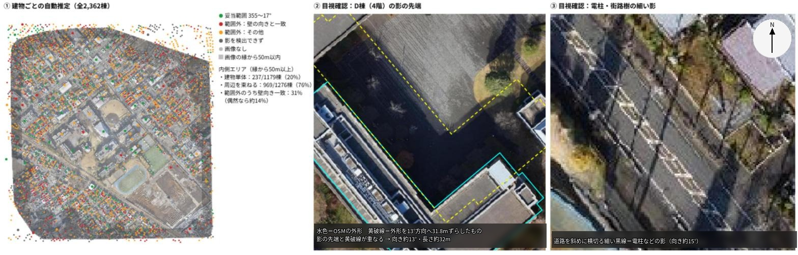

# 影の向きの検証（試行）：研究室のドローン画像

> **位置づけ（2026年11月9日時点）**：本研究の手法を決めるための試行である。建物の高さはまだ推定していない。この試行に限り、自動推定が正しく動いているかの答え合わせとして、記録上の撮影時間帯から計算した影の向きを使った。本研究の手法では、Bingにも使えるよう撮影時刻の情報は使わない。

[README に戻る](../README.md)

## 結論

研究室のドローン画像に写るOSMの建物2,362棟すべてで、影の向きを自動で推定した。**建物1棟ずつの推定では、妥当な向きはほとんど得られなかった**（画像の内側で20%）。一方、電柱の影などの目印を使って目で確かめた3か所では、影の向きを約10〜15°と読み取れ、答え合わせに使った範囲（358°〜14°）とも合っていた。

このため本研究では、**影の向きは区画ごとに少数の目印で確かめる**。建物ごとに測るのは、その向きに沿った影の長さだけにする。

①全建物の自動推定の結果（緑＝妥当な範囲、赤＝壁の向きに引っぱられた推定、橙＝その他の外れ、灰＝影を検出できず・画像なし、暗い帯＝画像の縁から50m以内）。②D棟（4階）の影の先端と、OSMの外形を13°方向に31.8mずらした線（黄破線）の重なり。③道路を斜めに横切る電柱・街路樹の細い影。

## 使ったデータ

| データ | 内容 | 出典・ライセンス |
| --- | --- | --- |
| 航空写真 | 研究室のドローン画像「sagamihara20211215aoyamauniv1155mapconcierge00arw01」。2021年12月15日 11:30〜12:30（日本時間）撮影、地上画素寸法 約2.7cm。解析ではズーム19（約0.24m/画素）のタイルとして読み込んだ | OpenAerialMap、提供 CrisisMappersJapan/DRONEBIRD/FuruhashiLab/YouthMappersAGU、CC BY 4.0 |
| 建物の外形 | 画像の範囲（東経139.397592〜139.40876°、北緯35.562283〜35.571917°）の `building` タグを持つ way・relation | © OpenStreetMap contributors、ODbL |

## 答え合わせに使った影の向き

自動推定の結果を確かめるためだけに、NOAAの太陽位置の式で、北緯35.567°・東経139.403°、2021年12月15日の太陽の方位を計算した。影の向きは太陽の方位の反対（北を0°として時計回り）。

| 時刻（日本時間） | 影の向き |
| --- | --- |
| 11:30 | 358.0° |
| 12:00 | 6.0° |
| 12:30 | 13.9° |

記録上の撮影時間帯は11:30〜12:30なので、影の向きは358°〜14°の範囲に入るはずである。

## 自動推定の方法

`src/shadow_direction_browser.js` で、Claudeがブラウザ上でOSMの建物とドローン画像を取り込み、次の手順で推定した。

1. 画素の明るさが35以下を「影」、60以上を「日なた」とする（間は直線でつなぐ）。
2. 建物の外形から方向θへ帯を伸ばす。帯の中が暗いほど、帯の左右と先が明るいほど点を高くする。他の建物に当たった所は減点する。影の長さは3〜60mの範囲で最も点が高くなる長さを選ぶ。
3. θを全方位で3°刻みに調べ、最も点の高い向きの前後を1°刻みで調べ直す。
4. 周りの建物を束ねた向きは、半径約60m（ガウス重み）の建物の点数の曲線を足し合わせ、最も高い向きとした。画像の縁に近い建物（周り30m四方の2%超に画像がない）は、束ねる材料から外した。
5. 答え合わせの範囲は、358°〜14°に±3°の余裕を見て **355°〜17°** とした。

## 結果

| 区分 | 妥当な範囲に入った建物 |
| --- | --- |
| 対象 | 2,362棟（画像がないもの372棟、画像の縁から50m以内712棟、内側1,278棟） |
| 内側：建物1棟ずつの推定 | **237 / 1,179棟（20%）** |
| 内側：周りの建物を束ねた推定 | **969 / 1,276棟（76%）** |
| 画像の縁から50m以内：建物1棟ずつの推定 | 41 / 433棟（9%） |

内側の建物1棟ずつの推定を、建物の大きさ別に見ると次のとおり。大きい建物ほど当たりやすいが、1,000㎡以上でも半分程度である。

| 建物の面積 | 妥当な範囲に入った建物 |
| --- | --- |
| 80㎡未満 | 116 / 677棟（17%） |
| 80〜150㎡ | 58 / 311棟（19%） |
| 150〜300㎡ | 35 / 128棟（27%） |
| 300〜1,000㎡ | 16 / 40棟（40%） |
| 1,000㎡以上 | 12 / 23棟（52%） |

## 外れた理由

- **壁の向きに引っぱられる**：内側で範囲外になった942棟のうち291棟（31%）は、推定の向きが壁に垂直な向きと±6°以内で一致した。偶然なら約14%である。建物のすき間や壁ぎわの暗い帯を、影と取り違えている。
- **影が隣の建物に落ちる**：住宅地では、影の大部分が北側の家の屋根に落ちる。地面に見える影は細いすき間だけになり、向きが決まらない。
- **画像の縁がゆがむ**：外周50mほどは写真がつぶれ、OSMの外形とも合わない。
- **束ねても誤る街区がある**：内側で束ねた推定が300〜345°になった建物が213棟あった。同じ向きのタウンハウスが並ぶ街区では329°になったが、すぐ横の道路の電柱の影は約15°だった。

## 目で確かめた3か所

| 場所 | 手がかり | 影の向き | わかったこと |
| --- | --- | --- | --- |
| D棟（4階）北側の広場 | 屋上の輪郭が地面に落ちた影の先端 | 約13° | 外形を13°方向に31.8mずらすと影の先端と重なる |
| 公園わきの住宅 | 影の先端の位置 | 10°前後 | 外形を10°方向へ12mずらした位置に影がある（向きを精密に測ったものではない） |
| 運動場東側の道路 | 電柱・街路樹の細い影 | 約15° | 道路を斜めに横切る直線として写っている |

## 研究の進め方への示唆

1. 影の向きは画像から1棟ずつ測らず、**区画ごとに少数の目印（大きな建物の影の先端、電柱の影）で確かめる**。撮影時刻の情報は使わない。
2. 建物ごとに測るのは**その向きに沿った影の長さだけ**にする。対象は、影が他の建物に当たらず地面に落ちる建物（道路・駐車場・広場に面した建物）に限り、測れない建物の数も報告する。
3. 高さは、近くの基準建物との影の長さの比で求める。これならBingのように撮影時刻が分からない画像にも同じ手順で使える。
4. OpenAerialMapには、同じ飛行のDSM（地表の高さのデータ）「…arw01dsm」も公開されている。建物の高さの確認に使える可能性がある【要確認】。

## 再現の方法

1. Google Chromeで https://titiler.hotosm.org/ を開く。
2. 開発者ツール（F12）のConsoleに `src/shadow_direction_browser.js` の中身を貼り付ける。
3. `await ShadowDir.run()` を実行する（約1分）。上の表と同じ数が表示される。
4. 建物ごとの表は `ShadowDir.downloadCSV()` で保存できる。

OSMの建物は実行時点のデータを取得するため、OSMが更新されると数が変わることがある。上の結果は2026年11月9日に取得したデータによる。

## 出典

- 画像：OpenAerialMap「sagamihara20211215aoyamauniv1155mapconcierge00arw01」、CrisisMappersJapan/DRONEBIRD/FuruhashiLab/YouthMappersAGU、CC BY 4.0
- 建物：© OpenStreetMap contributors、ODbL
- 太陽位置（答え合わせのみ）：NOAA Global Monitoring Laboratory, Solar Calculator の計算式
